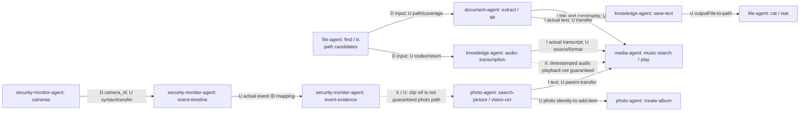

# Cross-agent composition graph

This is a **contract-level hypothesis graph**, not a runtime trace. All paths are authorized user-provided or actual returned values; no assumed identity conversion. Class labels: **D** documented parameter/result concept, **I** parent interpretation, **U** output-format or handoff unverified, **X** unsupported primitive. D does not establish parent-visible stable return, actual success or completeness. See the [catalog](02-operation-catalog.md) for exact types and owner.

| Edge / required actual payload | Contract and what could go wrong | Scope / user action / observed completion |
|---|---|---|
| `find`→`document:extract`: real accessible file path; `extract` requires query | **D + U:** `find` summary says real path; `extract` accepts `file` and `query`, but shape, supported file, bytes and transfer are unknown. | User authorizes path; child `completed` plus actual evidence, not a request alone. Empty or capped list → limited coverage. |
| `find`→`audio-transcription`: real authorized audio path | **D + U:** path accepted but audio codecs, `sourcePath`, timestamps and visibility unknown. | Ask owner for scope; empty transcript means unreadable/no result, not proof no speech. |
| `vision-ocr`→`music:search`: actual transcript / printed song, parent derives `type=song`, keyword | **I + U:** cross-domain semantic identity needs user check, not a deterministic ID mapping; search accepts keyword and may play. | Scope and explicit play intent; if OCR or search ambiguous ask user, no invented title. Playback counts as state change. |
| `audio-transcription`→`video:search`: actual recognized title supplied as keyword | **I + U:** title may be misheard, media may be missing or wrong; no automatic speech timestamp or jump is guaranteed. | User confirms ambiguous match and play; actual completed outcome required. |
| `cameras`→`event-timeline`: actual camera_id and user time interval | **D + U:** `cameras` return summary names `camera_id`; query accepts `camera-id`. Spelling difference likely only label, actual value compatibility undocumented. | Scope strictly to consented camera; limit and event warnings, no absence-of-activity claim. |
| `event-timeline`→`event-evidence`: actual event ID | **U:** timeline says event items but does not guarantee an exact ID field; evidence requires `event-id` and has clip/snapshot enum. | Only actual returned ID; expired/inaccessible evidence → report unknown; no assumed URL or clip playback. |
| Photo search→album `add-item` | **U:** source identity and `add-item` exist but format, membership, original preservation and atomicity undefined. | Separate explicit album choice and workflow approval. No claim album created on `waiting_approval`, and no repeat on unknown outcome. |
| Document write→knowledge `save-text`→file `cat` | **I + U:** writing may return `draft`, save accepts `content`, return summary mentions `outputFile`; no assurance of real values or parent transformation. | Content/source constraints and explicit save approval; read back if actual path and access; cannot guarantee no overwrite. |
| `file-workflow:start`→`run` | **D + U:** `start` describes plan and `id`; run takes `id` or `start.data.id`. A plan is not execution, and ID mapping and resumption are untested. | Explicit approval and `workflow` handling, precondition recheck; avoid destructive variants in a creative demo. |
| Subtitle search→download | **D + U:** `subtitle-search` says `file-id`; download accepts integer `file-id` and `video-path`. No provider origin, matching correctness or returned ID type guarantee. | Show candidate and obtain exact user consent; download is `gateway`. Unsupported safe overwrite guarantee. |

**Common state handling:** `waiting_user`/`waiting_approval` means pause without fabricating the next step; `failed`/`cancelled` stop dependents and preserve partial observations; `completed` does not eliminate action-specific verification requirements. Paths, IDs, timestamps and returned coverage are not inferred. No automatic event triggers or guaranteed cross-agent data plane is documented.
